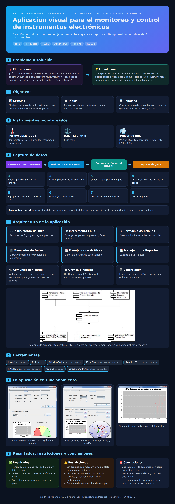

# Sistema de Monitoreo y Control de Instrumentos Electrónicos

> **Autor:** Ing. Diego Alejandro Amaya Arjona  
> **Proyecto:** Aplicación visual en Java para la adquisición, procesamiento y visualización en tiempo real de datos mediante comunicación serial.


> **Descripción:** Estación central de monitoreo desarrollada en **Java** que se comunica con instrumentos electrónicos por **puerto serial**, procesa sus datos y los presenta en **gráficas en tiempo real** y **tablas dinámicas**, con exportación de reportes a **PDF** y **Excel**.

<p align="center">
  
</p>

---

## Resumen Ejecutivo & Objetivos

| Elemento | Descripción |
| :--- | :--- |
| **Problema** | Necesidad de capturar, procesar y visualizar de forma centralizada variables físicas (humedad, temperatura, flujo, volumen, peso) desde múltiples instrumentos electrónicos. |
| **Solución** | Estación centralizada de monitoreo desarrollada en Java con gráficos dinámicos en tiempo real y exportación automática de reportes. |
| **Alcance** | Monitoreo y control continuo sobre **3 instrumentos clave** conectables por puerto serial. |

---

## Planteamiento del Problema

¿Cómo obtener la información de un conjunto de instrumentos electrónicos para monitorear y controlar las variables más importantes (humedad, temperatura, flujo, volumen, etc.) mediante una interfaz gráfica de usuario que permita análisis más detallados?

Cada instrumento entrega sus registros de forma distinta, por lo que el tratamiento de los datos varía sustancialmente de uno a otro.

## Objetivos

**General:** desarrollar una aplicación gráfica que facilite el monitoreo y control de los datos obtenidos de un conjunto de instrumentos.

**Específicos:**

1. Crear una interfaz que facilite la captura de datos de cualquier instrumento y permita generar reportes en PDF.
2. Mostrar los datos de cada instrumento de forma gráfica y distribuirlos en componentes emergentes.
3. Recopilar los datos de forma tabular, en un formato único y ordenado.

---

## Instrumentos y Variables Medidas

```
  +-----------------------------------------------------------------------+
  |                      ESTACIÓN CENTRAL DE MONITOREO                    |
  +-----------------------------------+-----------------------------------+
                                      |
       +------------------------------+------------------------------+
       |                              |                              |
       v                              v                              v
+--------------+               +--------------+               +--------------+
| Termocuplas  |               |   Balanza    |               |  Sensor de   |
| (Arduino/K)  |               |   Digital    |               |    Flujo     |
+--------------+               +--------------+               +--------------+
| - Temp. T1   |               | - Peso Real  |               | - Presión    |
| - Temp. T2   |               |   (kg/g)     |               | - Temp (C)  |
| - Humedad    |               |              |               | - Flow (LPM) |
+--------------+               +--------------+               +--------------+
```

---

## Flujo de Implementación del Sistema

```
 [1. Comunicación]  -> 	  [2. Recepción]   -> 	[3. Procesamiento] -> [4. Interfaz / GUI]
  - Puerto Serial         - Captura de          - Validaciones         - Tablas dinámicas
  - RS-232 / USB            datos brutos        - Fórmulas de          - Gráficos JFreeChart
  - Drivers Java                                  calibración          - Exportación PDF/Excel
```

---

## Ajustes y Fórmulas de Calibración (Arduino)

Para garantizar la precisión de los datos analógicos leídos, se aplican las siguientes transformaciones matemáticas:

* **Temperatura 1 ($T_1$):**
  $$T_1 = \frac{15.381 \times 5.1 \times \text{lectura}_1}{1024}$$

* **Temperatura 2 ($T_2$):**
  $$T_2 = \frac{9.196 \times 5.1 \times \text{lectura}_2}{1024}$$

* **Humedad ($H_3$):**
  $$H_3 = \frac{5.0 \times \text{lectura}_3 \times 100}{1024}$$

---

## Captura de datos

```
Sensores / Instrumentos ──► Arduino · RS-232 (USB) ──► Comunicación serial (RXTX) ──► Aplicación Java
```

**Arduino:** un circuito con sensores de humedad y temperatura toma datos del ambiente, y un algoritmo lee los sensores reales de las termocuplas, valida los datos y los emite de forma ininterrumpida.

**Comunicación serial:** el algoritmo seguido para cada instrumento es:

1. Buscar los puertos seriales y guardarlos en una lista.
2. Definir los parámetros de conexión.
3. Conectarse al puerto seleccionado.
4. Inicializar los flujos de entrada y salida.
5. Agregar un listener para recibir los datos.
6. Enviar y/o recibir los datos.
7. Desconectarse del puerto.
8. Cerrar el puerto.

**Parámetros de comunicación:**

| Parámetro | Descripción |
| --- | --- |
| Velocidad | Cantidad de bits por segundo |
| Paridad | Mecanismo para detectar inconsistencias o errores en los datos enviados |
| Bit de parada | Indica cuándo termina una trama |
| Control de flujo | Controla el envío desde y hacia el puerto serial |

---


## Configuración del Puerto Serial (RS-232 / COM)

```
       +----------------------------------------------------+
       |         Parámetros de Conexión Serial              |
       +-----------------------+----------------------------+
       | Tasa de Baudios       | 9600 bps                   |
       | Bits de Datos         | 8 bits                     |
       | Paridad               | Ninguna (0)                |
       | Bits de Parada        | 1 bit                      |
       | Control de Flujo      | Hardware / None            |
       +-----------------------+----------------------------+
```


---

## Arquitectura

| Componente | Funcionalidad |
| --- | --- |
| Instrumento de medición de balanza | Controla el acceso y los flujos del instrumento y entrega el peso real |
| Instrumento de medición de flujo | Controla los flujos y entrega temperatura, presión y flujo másico |
| Instrumento de medición de termocuplas (Arduino) | Controla los flujos que provienen de las termocuplas montadas en Arduino |
| Manejador de datos | Gestiona la extracción y el procesamiento de las variables del monitoreo |
| Manejador de gráficas | Genera la gráfica de cada variable |
| Manejador de reportes | Genera reportes en PDF y Excel de cada variable |

Programas que integran la aplicación:

- **Comunicación serial:** valida la conexión al puerto, ejecuta el listener y, mediante el evento `SerialEvent`, trata los datos y genera la traza de captura.
- **Gráfica dinámica:** visualiza en tiempo real las constantes procesadas, usando un `Timer` (demonio) que dispara el contador de tiempo.
- **Controlador de la aplicación:** integra la comunicación serial con las gráficas dinámicas.

---

## Diagrama de arquitectura del software

```
                         +--------------------------+
                         |    Cliente del Proceso   |
                         +------------+-------------+
                                      |
         +----------------------------+----------------------------+
         |                            |                            |
         v                            v                            v
+------------------+        +------------------+        +------------------+
| Manejador Datos  |        | Manejador Chart  |        | Manejador Reporte|
|   del Proceso    |        |   (JFreeChart)   |        |   (Apache POI)   |
+------------------+        +------------------+        +------------------+
         |                            |                            |
         +----------------------------+----------------------------+
                                      |
       +------------------------------+------------------------------+
       |                              |                              |
       v                              v                              v
+--------------+               +--------------+               +--------------+
| Driver Peso  |               | Driver Flujo |               | Driver Temp  |
| (Mettler)    |               | (EW-32907)   |               |  (Arduino)   |
+--------------+               +--------------+               +--------------+
```

---

## Tech Stack

* **Lenguaje:** Java 
* **IDE:** Eclipse + WindowBuilder
* **Librería de Gráficos:** JFreeChart
* **Comunicación Serial:** RXTXcomm / Java Communications API
* **Generación de Reportes:** Apache POI (PDF y Excel)
* **Hardware & Emulación:** Arduino IDE, VirtualSerialPort

---

## Cómo ejecutarlo

> Ajusta los pasos a la estructura real de tu repositorio.

1. Clona el repositorio:

   ```bash
   git clone https://github.com/daamayaaa/<nombre-del-repositorio>.git
   ```

2. Abre el proyecto en **Eclipse** e incluye en el *build path* las librerías **JFreeChart**, **Apache POI** y **RXTXcomm**.
3. Si no tienes los instrumentos físicos, usa **VirtualSerialPort** para emular los puertos seriales.
4. Ejecuta la clase principal desde Eclipse (*Run As → Java Application*).
5. En la aplicación, selecciona el puerto serial, define los parámetros de conexión y conecta el instrumento.

---


## Resultados

- Monitoreo en tiempo real de la **balanza** y del **flujo másico**, con gráficas y medidores.
- Tablas dinámicas con los datos capturados.
- Reportes en **PDF** y **XLS**: el usuario puede exportar el contenido de las tablas aunque se sigan generando datos, y recibe un mensaje cuando el reporte se genera correctamente.

---

## Desafíos y Restricciones Técnicas

1. **Procesamiento Paralelo Limitado:** Desafíos de eficiencia al leer múltiples puertos simultáneamente.
2. **Dependencia de Calibración:** Alto acoplamiento con la velocidad y formato de respuesta de hardware específico.
3. **Carga Computacional:** Las gráficas multivariable en tiempo real requieren recursos estables en el equipo host.

---

##  Conclusiones

* Se logró una interfaz gráfica funcional, modular e intuitiva para el control de variables físicas heterogéneas.
* El manejo de eventos seriales en Java permitió una recepción eficiente y estructurada de tramas de datos.
* La automatización de reportes (PDF/XLS) optimiza la toma de decisiones y el almacenamiento histórico de las lecturas.

---

## Autor

**Ing. Diego Alejandro Amaya Arjona, Esp.**
Tecnólogo en Informática · Ingeniero de Sistemas · Especialista en Desarrollo de Software